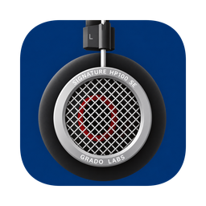
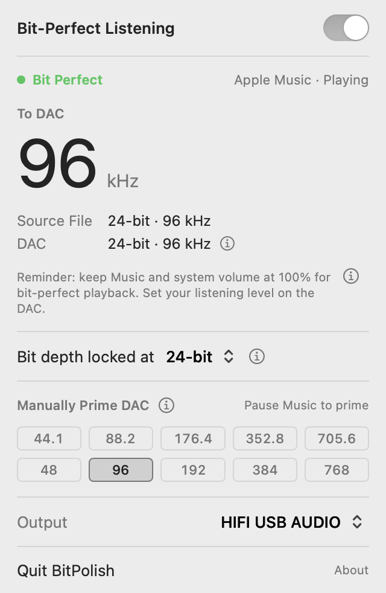

<p align="center">
  
</p>

<h1 align="center">BitPolish</h1>

<p align="center"><strong>Bit-perfect playback for Apple Music and your local library.</strong><br>
Keep using Apple Music. BitPolish adds the one thing it cannot do: it sets your DAC to each track's sample rate, locks the bit depth, and puts everything back when you are done.</p>

<p align="center">
  <a href="https://github.com/blockstarsoftware/BitPolish/releases/latest"><strong>Download</strong></a> ·
  <a href="https://blockstarsoftware.com/projects/bitpolish/">Website</a> ·
  <a href="docs/VERIFICATION.md">How it was tested</a>
</p>

<p align="center">
  <picture>
    <source media="(prefers-color-scheme: dark)" srcset="docs/images/panel-dark.png">
    
  </picture>
</p>

BitPolish is a macOS menu-bar app with one switch: **Bit-Perfect Listening**. While it is On, it keeps your external DAC at the sample rate of whatever Apple Music is playing, with the bit depth locked (24-bit by default; a DAC that goes higher can be set to its maximum), so the music reaches your DAC unaltered. Switch it Off, or quit, and the DAC goes back to exactly how it was.

**For Apple Music listeners with great hi-fi gear.** You own your music: high-resolution files, 96 kHz, 192 kHz. You play them in Apple Music: your library, your playlists, one app. And you have great headphones or speakers, a great DAC and amp, a system built to deliver all the detail the recording has.

There is only one problem. Apple Music does not offer bit-perfect playback of local high-resolution files. macOS runs your sound output at one standard setting, often 44.1 or 48 kHz at 16-bit, and that setting does not change when you play local music in Apple Music. macOS has no way to automatically switch to the higher rate and bit depth a track needs. So your 96 kHz and 192 kHz files, most of them 24-bit, are converted down to 16-bit and the standard rate before they reach your DAC, and the detail in your files never makes it there.

Fortunately, there is BitPolish. You keep using Apple Music on your local files, and the music reaches your hardware the way the file was made, at its sample rate and its bit depth.

## What exactly does BitPolish do?

Switch on Bit-Perfect Listening, press play in Music, and BitPolish gets to work. It has two modes.

**Automatic.** BitPolish changes your DAC's sample rate on the fly. As each track starts, it sets the DAC to that track's rate, whatever the file is and your DAC supports, for Apple Lossless, AAC and MP3, and locks the bit depth at 24-bit by default, so 24-bit tracks stay 24-bit. A DAC that goes higher can be set to its maximum. Nothing is resampled on the way, so the samples reaching your DAC are the samples in the file.

**Manual.** Changing sample rate takes the DAC a moment, about a second on some hardware, so in automatic mode a track at a new rate begins after a short gap. If you know what plays next, **Manually Prime DAC** removes it. It is a row of rate buttons in BitPolish's panel: pause Music, click the rate of the track you are about to play (Get Info in Music shows each file's rate), then press Play. The DAC switches while nothing is playing, so the track starts clean. You never have to use it. It is there for the tracks where the gap would bother you.

Switch it off, and everything goes back the way it was.

Free and open source. Made by Blockstar Software.

> Early release. Apple Music only. Works with every codec Music decodes; uncompressed AIFF/WAV formats are not detected yet.

## Contents

- [Why it exists](#why-it-exists)
- [What exactly does BitPolish do?](#what-exactly-does-bitpolish-do)
- [Features](#features)
- [Who it's for](#who-its-for)
- [Built for listening sessions](#built-for-listening-sessions)
- [Using it](#using-it)
- [Know your chain's limits](#know-your-chains-limits)
- [Principles](#principles)
- [Tested, not assumed](#tested-not-assumed)
- [Requirements](#requirements)
- [Limitations](#limitations)
- [Building from source](#building-from-source)
- [Pass the goodwill on](#pass-the-goodwill-on)
- [License](#license)

## Why it exists

Apple Music plays everything at whatever sample rate the Mac's output is already set to. If that doesn't match the track, macOS resamples it before it reaches your DAC. Music never changes the DAC's rate itself.

A small app called BitPurfect filled that gap by switching the DAC's rate to follow each track. It left the bit depth at 16-bit, so 24-bit tracks were cut down to 16 bits on the way out, and its menu wouldn't close on a second click. The developer has since taken its page down and its source is gone, so neither could be fixed.

BitPolish rebuilds the idea from scratch, as open source so it can't disappear the same way. It also addresses the complaints people have raised about Apple Music and external DACs:

- **Music doesn't change the DAC's rate.** BitPolish does, track by track, for Apple Lossless, AAC and MP3 (AIFF and WAV aren't detected yet).
- **A mismatched rate gets resampled.** BitPolish matches it. If your DAC can't take a track's rate (some adapters skip 88.2 kHz), the panel tells you instead of letting it pass silently.
- **Music is said to resample local files to the rate the DAC had when Music launched** ([LosslessSwitcher discussion #74](https://github.com/vincentneo/LosslessSwitcher/discussions/74), 2023). This was tested directly on macOS 27: Music's output was captured on its way to the DAC and matched the file bit for bit, even after a rate change. [How it was tested](docs/VERIFICATION.md).
- **Music doesn't take exclusive control of the DAC**, so other apps' sounds can mix in. BitPolish can't change that; close other audio sources while you listen.

## Features

And the details that make it trustworthy:

- **Tells you the truth.** An asterisk beside the rate in the menu bar means playback is not bit-perfect right now, because the volume is below 100% or your DAC refuses the rate. The panel says which. Rates your DAC will not take are faded.
- **Restores everything.** Before it touches your DAC, BitPolish saves its format. Switching off, quitting, relaunching after a crash or replugging the DAC brings it back exactly as it was. BitPolish never changes volume.
- **Never surprises your speakers.** If BitPolish moved your sound to the DAC, it stays there until you click **Return to …**, so nothing suddenly plays out loud.
- **Choose your DAC.** With more than one DAC, pick which in the **DAC** menu. While Off, the pick only sets the DAC for the session.
- **Leave it on, or not.** **Open at login**, **Keep Bit-Perfect Listening on** and **Show in Dock** are in the Option-click Details. By default it does none of them.
- **Updates itself while it runs.** A daily check through [Sparkle](https://sparkle-project.org); nothing runs when BitPolish is not open.

## Who it's for

BitPolish was made for people with local libraries of high-resolution files who still use Apple Music. That's the ecosystem they're in, and they'd rather not add a separate audio player. In exchange they accept a little friction: when a track at a new sample rate starts, the DAC needs a moment to switch (about a second on some hardware), so there's a short gap.

For the times you know what you want to play next and can stop between tracks, there's **Manually Prime DAC**. Pause Music, choose the next track's sample rate in BitPolish's panel, then press Play. The DAC changes rate while nothing is playing, so the track starts without the gap.

Dedicated players such as Audirvana and Roon are great and well made, and plenty of people are happy moving to one. If you'd rather stay with Apple Music and your own files and still get bit-perfect playback, this is for you.

It's also for people who like small, unobtrusive apps. Launch BitPolish when you sit down to listen and quit it when you're done. Quit it and nothing stays behind: no background helper, no login item, no menu-bar icon. It never asks for permission to control your apps, read your library or record audio. If you want it to start at login, check **Open at login** in the Option-click Details. When you need it, it's there. Enjoy your listening sessions.

## Built for listening sessions

BitPolish is built around one idea: the listening session. You sit down with your music, switch BitPolish on, listen, and switch it off when you're done. Everything in the app follows from that.

While it is on, it follows the music. Pause, and the DAC holds the last track's rate, so pressing Play picks up right where you left off, with no gap.

When the session ends, BitPolish steps aside. Switching it off returns your DAC to exactly how it was. If BitPolish moved your sound to the DAC, it stays there until you choose to send it back to your speakers, so nothing suddenly plays out loud. Quit BitPolish and nothing keeps running.

Between sessions, BitPolish leaves your Mac alone. It doesn't start at login unless you add it yourself, it never asks for permission to control your other apps, and while it's off it changes nothing.

**Or leave it on.** If your DAC or audio interface stays connected to your speakers or headphones all day, BitPolish works for that too. Hold Option while you click BitPolish's menu-bar readout; at the bottom of the Details section, check **Open at login** and **Keep Bit-Perfect Listening on**. BitPolish then opens with your Mac, switches on by itself, and switches back on whenever your DAC reconnects (after unplugging it, or docking your Mac). Sounds from other apps play through it as well, converted to the current track's rate, which you won't hear. To keep alert and notification sounds out of your music, send them to the Mac's own speakers: **System Settings › Sound › Sound Effects › Play sound effects through**.

## Using it

> **Protect your ears and your speakers.** For bit-perfect playback, the Mac and Music stay at 100% volume, which sends the full signal to your DAC. Before you raise them, turn your DAC or amp all the way down, then bring the level up slowly once music is playing. This matters most with headphones.

1. Connect your DAC (USB, or a USB-to-optical adapter, HDMI, Thunderbolt) and turn it, or your amp, down.
2. Launch BitPolish, click its readout in the menu bar, and switch on **Bit-Perfect Listening**. If the Mac's sound isn't already on your DAC, BitPolish switches it there. With more than one DAC, choose which in BitPolish's **Output** menu first: while Off, the menu only picks the DAC for the session (and shows what it accepts), and the Mac's output doesn't change until you switch on. BitPolish remembers the pick. While On, the Output menu moves between DACs. While Off, BitPolish never changes the Mac's output, except **Return to …** when you click it.
3. With the DAC or amp still down, set the Mac's volume and Music's volume slider to **100%**, then raise your listening level on the DAC or amp.
4. Play music in Apple Music.

An asterisk on the menu-bar rate ("96 kHz*") means playback isn't bit-perfect right now: the system volume is below 100%, or your DAC doesn't accept the track's rate and macOS is resampling. The rate shown is still what's going to your DAC; open the panel to see which it is.

To skip the gap when the next track is at a different sample rate: pause Music, click that rate under **Manually Prime DAC** in the panel, then play the track. The rates sit in two rows by family (44.1 kHz family on top, 48 kHz below); faded ones are rates your DAC doesn't accept, and tracks at those rates play at the next rate up, resampled.

While Bit-Perfect Listening is off, the panel lists every rate and bit depth your DAC accepts. While it's on, the Manually Prime DAC buttons show the same thing, and holding Option while you click the readout brings the full list back. The Details section also holds three settings: **Open at login**, **Keep Bit-Perfect Listening on**, and **Show in Dock**, which gives BitPolish a Dock icon while it runs (click it to open the panel; its menu flips the switch). About BitPolish (with Check for Updates…) and Quit are at the bottom of the panel; the readout's right-click menu has About, Check for Updates… and Quit.

Switch it off (or quit BitPolish) when you're done; the DAC goes back to how it was. If BitPolish moved your sound from the speakers (or Bluetooth, AirPlay) to the DAC, the sound stays on the DAC until you click **Return to …** in the panel, so nothing suddenly plays out loud; a session that started on another DAC returns there automatically.

The first time BitPolish opens, a short welcome window explains all this once. It doesn't come back after updates; to see it again, run `defaults delete com.blockstarsoftware.BitPolish WelcomeShown` in Terminal and relaunch.

## Know your chain's limits

A track only arrives bit-perfect if every link in the chain can carry it: your Mac, any adapter, the cable, and the DAC's input. The chain is only as capable as its weakest link, so it's worth knowing the real maximum sample rate and bit depth of each link, and what rates your music actually uses.

**What macOS shows isn't always what reaches your DAC.** BitPolish, like Audio MIDI Setup, shows the formats a device offers over USB. For a DAC plugged straight into the Mac, that's the DAC itself. For an adapter (USB to optical or coax), it's only the adapter's USB side. Many adapters are built around a general-purpose USB audio chip whose standard firmware advertises 32-bit and rates up to 768 kHz, because the same chip feeds DAC chips directly in other products. What the adapter can actually send out its optical or coax jack is often much less.

**Optical and coax carry at most 24 bits.** That's a limit of the S/PDIF format itself. An adapter that offers 32-bit to macOS still sends 24 bits out of its optical or coax jack. With 16- or 24-bit music nothing is lost, because the extra bits are empty. But choosing 32-bit in BitPolish gains nothing over S/PDIF, so leave these adapters at the 24-bit default. Choose the device maximum only for a DAC that takes the higher bit depth directly over USB.

**Sample rates depend on the adapter's output, the cable, and the DAC's input.**
- Look up each one separately: the adapter's output spec (not its USB spec), and your DAC's spec for the specific input you use. DACs often accept different maximum rates on USB, coax and optical.
- Optical is generally reliable up to 192 kHz.
- Cables vary. Some optical cables drop out at 176.4 or 192 kHz even when everything else supports it; it can take more than one cable to find one that holds.
- Optical cables known to hold 192 kHz: [KabelDirekt Optical TOSLINK Cable](https://www.amazon.com/dp/B00DI89WDW), sold in several lengths, all of which have held 192 kHz from a Douk Audio U2 adapter into a Chord Hugo M Scaler.
- An adapter may advertise rates above what its output can carry. What happens if you send it one of those rates depends on the adapter: it might resample, go silent, or send a signal your DAC can't lock to.

**Check your music too.** In Apple Music, select a track and choose **Get Info › File** to see its sample rate (BitPolish's panel shows the playing track's bit depth too). If nothing you own goes above 192 kHz, the higher rates in the chain don't matter.

**A quick test of the whole chain:** pause Music, use **Manually Prime DAC** to set a rate, then play a track at that rate and watch your DAC's display or rate indicator. If it locks and plays cleanly at every rate you own, the chain is good. If it drops out at the higher rates, suspect the cable or the adapter's output first.

BitPolish can only see as far as the device plugged into your Mac. It fades the rates that device refuses, but it can't know what an adapter's output, a cable, or the DAC behind it will take.

## Principles

- **No permission prompts.** No AppleScript, Accessibility, audio recording or Media Library access. BitPolish reads Music's own log (track formats, and the title of a track already playing when BitPolish launches), its track-change notifications, and the system's open-file table.
- **Hands off when Off.** It reads, but changes nothing (except **Return to …**, when you click it).
- **External DACs only.** Built-in output, Bluetooth, AirPlay and virtual devices are refused (they can't be bit-perfect or aren't DACs).
- **No Dock icon, and no launch at login, unless you choose them.** Launch it when you want to listen, or check **Open at login** or **Show in Dock** in the Option-click Details.
- **Updates only while it runs.** A daily check through Sparkle while BitPolish is open; nothing runs when it isn't.

## Tested, not assumed

"Bit-perfect" is easy to claim. A DAC's rate light proves the rate arrived, but the rate stays the same even when the samples are altered, so the samples themselves were measured.

Music's output was captured on its way to the DAC and compared sample by sample with the file. The result was bit-exact: gain 1.000000, the full spectrum present. That held even when Music was launched at a different rate than the DAC, a long-standing claim that did not hold on macOS 27.0.1. Restore safety was tested too: on and off, force-quit while on, unplugging the DAC mid-session, and another app changing the device behind BitPolish's back.

[`docs/VERIFICATION.md`](docs/VERIFICATION.md) gives the method, the results, what the tests do not cover, and how to repeat them on your own Mac.

## Requirements

- A Mac with Apple Silicon (M1 or later) and macOS 14 Sonoma or later.
- An **administrator account** for rate following: BitPolish reads Music's log with `log stream`, which macOS allows only for admin accounts. On a standard account BitPolish says so in its panel; the bit-depth lock still works.

## Limitations

- **Apple Music only.** Other players (Audirvana, Roon) manage the DAC themselves.
- **Not exclusive.** Apple Music shares the output, so any other app playing sound to the same device at the same time is mixed in. Close other audio sources while listening.
- **Rates the DAC can't take.** If your DAC (or adapter) doesn't offer a track's rate, macOS resamples it and BitPolish tells you so.
- **The first instant of a track** at a new rate can be resampled, followed by a short gap while the DAC changes rate, because the rate changes as Music starts the track. Manually Prime DAC avoids this when you know the next track's rate.
- **AIFF/WAV** formats aren't detected yet.

## Building from source

Apple's Command Line Tools with Swift 6 or later are enough; Xcode is not required.

```bash
./build.sh
swift run BitPolishChecks
```

Releasing, software updates, how it works, the source map and the developer test hooks are in [`docs/DEVELOPING.md`](docs/DEVELOPING.md).

## Pass the goodwill on

If BitPolish is useful to you, please consider a donation to [Unconditional Freedom](https://unconditionalfreedom.org/donate), a 501(c)(3) organization that builds for human flourishing. Every donation goes to them, not to me or to this app.

## License

MIT. See [LICENSE](LICENSE). Use it, change it, build on it, ship it, for any purpose.

BitPolish includes [Sparkle](https://sparkle-project.org) for software updates, also under the MIT License; its license ships inside the app as `Sparkle License.txt`.
